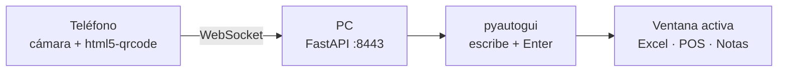

# scan-to-pc

**Escaneas con el teléfono. La PC escribe.**  
Lector de códigos de barras y QR 100 % local: la cámara del celular lee el código y lo tipea en la ventana activa de la PC (Excel, POS, Bloc de notas) por la red Wi-Fi — sin internet, sin nube, sin dependencias externas en el flujo.


---

## Cómo funciona



1. Arrancas el script en la PC: te muestra la URL y un QR en la terminal (y un ícono en la bandeja).
2. Abres la URL en Chrome/Safari desde el teléfono (misma Wi-Fi), tocas **Iniciar cámara**.
3. Apuntas al código: se decodifica en milisegundos y viaja por WebSocket a la PC.
4. La PC lo escribe donde esté el cursor y presiona **Enter** (como un lector de radiofrecuencia estándar).

---

## Arranque rápido

```powershell
python -m venv .venv
.\.venv\Scripts\pip install -r requirements.txt
.\.venv\Scripts\python server.py
```

| Paso | Qué ver |
|------|---------|
| 1 | URL tipo `https://192.168.x.x:8443` + QR ASCII en la terminal |
| 2 | Ícono de **barras de código** en la bandeja del sistema |
| 3 | Desde el teléfono: abrir la URL → **Avanzado → Continuar** (autofirmado) |
| 4 | **Iniciar cámara** → permiso de cámara → escanear |

En la PC también puedes abrir `https://localhost:8443` y tocar el botón **QR** para que el celular escanee el modal y entre solo.

---

## Compilar ejecutable (.exe)

Sin Python en la PC destino: un solo `scan-to-pc.exe` (onefile, ~27 MB) con ícono propio y bandeja incluida.

```powershell
.\.venv\Scripts\pip install pyinstaller
.\.venv\Scripts\pyinstaller scan-to-pc.spec --noconfirm --clean
```

| Resultado | Detalle |
|-----------|---------|
| `dist/scan-to-pc.exe` | Ejecutable autónomo en **modo bandeja puro** (doble clic y listo) |
| `dist/certs/` | Certificados generados junto al exe en el primer arranque |
| `dist/scan-to-pc.log` | Log de diagnóstico (sin consola) |
| `build/` | Temporales de PyInstaller (descartables) |

El `.spec` ya incluye el frontend (`static/`), el ícono, y los hidden imports de uvicorn/websockets/pystray. Compila con `console=False`: sin ventana, con notificación de la URL al arrancar y errores fatales en un cuadro de diálogo. Si quieres ver la consola con el banner QR, pon `console=True` en el `.spec` y recompila.

---

## Funciones

| Función | Detalle |
|---------|---------|
| Escaneo continuo | QR, EAN-13/8, UPC-A/E, Code 128/39/93, ITF, Codabar |
| Enter estándar | ON por defecto; se apaga desde el teléfono |
| Retraso configurable | 0–5 s antes de tipear (default 0.5 s) |
| Debounce | El mismo código no se reenvía en 1,5 s |
| Sonido | Beep de 2 kHz al escanear, con toggle en la app |
| Feedback | Beep + vibración (Android) + estado "Enviado" en el historial |
| Bandeja | Abrir en navegador / Salir |
| QR en la app | Modal con la dirección para emparejar otro teléfono |
| HTTPS local | Certificado autofirmado autogenerado en `certs/` |

---

## Interfaz del teléfono

```
┌────────────────────────────┐
│ ◆ scan-to-pc     ● Conectado│
├────────────────────────────┤
│ ┌────────────────────────┐ │
│ │      [  cámara  ]      │ │
│ │      ── haz ──         │ │
│ └────────────────────────┘ │
│ [ Iniciar cámara ]  [ QR ] │
│                            │
│ Último código              │
│ 7501234567890              │
│ Enviado a la PC            │
│                            │
│ ☑ Enter al enviar  ☑ Sonido│
│ Retraso 0.5 s              │
│ Historial                  │
│ 7501234567890        12:03 │
└────────────────────────────┘
```

---

## Configuración y red

| Tema | Comando / valor |
|------|-----------------|
| Puerto | `8443` (HTTPS) — cambia `PORT` en `server.py` |
| Firewall (si el teléfono no conecta) | `netsh advfirewall firewall add rule name="scan-to-pc" dir=in action=allow protocol=TCP localport=8443` |
| Certificados | Se generan solos en `certs/` en el primer arranque |
| Requisito | PC y teléfono en la **misma red Wi-Fi** |

---

## Solución de problemas

| Síntoma | Causa probable | Arreglo |
|---------|----------------|---------|
| El teléfono no abre la página | Firewall o red distinta | Regla de firewall; misma Wi-Fi; IP correcta en el banner |
| Cámara bloqueada | Página sin contexto seguro o permiso denegado | Aceptar el certificado autofirmado; permiso del sitio en el navegador |
| Aparece "Sin conexión" | El servidor no está corriendo | Abre el exe de nuevo; revisa la bandeja |
| No escribe en la PC | Ventana sin foco o delay 0 | Clic en la ventana destino; subir el retraso en el teléfono |
| No suena el beep (iPhone) | El navegador bloquea el audio hasta el primer toque | Toca **Iniciar cámara** una vez: eso desbloquea el audio. Si sigue mudo, revisa el switch físico de silencio |
| El beep suena pero no vibra | iOS no soporta vibración por web | Es normal: la vibración solo funciona en Android |
| Código repetido | Debounce apagado / escaneo muy lento | Normal: 1,5 s entre envíos del mismo código |

---

## Stack

| Capa | Tecnología |
|------|------------|
| Servidor + WS | FastAPI, uvicorn, websockets |
| Teclado | pyautogui + pyperclip (fallback de portapapeles) |
| Certificados | cryptography (SAN con tu IP local) |
| QR terminal / API | qrcode + Pillow |
| Bandeja | pystray |
| Escáner móvil | html5-qrcode (vendorizado en `static/`) |

---

## Estructura

```
scan-to-pc/
├── server.py              # HTTPS + WebSocket + API QR + bandeja
├── keyboard.py            # escribe el código + Enter
├── scan-to-pc.spec        # receta PyInstaller (onefile + ícono)
├── static/
│   ├── index.html         # UI del escáner
│   ├── html5-qrcode.min.js
│   ├── favicon.svg / .png
│   ├── apple-touch-icon.png
│   └── icon.ico           # ícono del .exe
├── certs/                 # autogenerados (gitignored)
├── requirements.txt
└── README.md
```

---

## Checklist antes de usar en producción interna

- [ ] PC y teléfono en la misma red (no exponer el puerto a red pública)
- [ ] Firewall permite TCP `8443` en redes privadas
- [ ] Probado con el código real de tu flujo (EAN/QR/Code128)
- [ ] Ventana destino enfocada antes de escanear (o retraso ≥ 0.5 s)

---

## Licencia / uso

Uso local y propio. El servidor acepta conexiones de **cualquier dispositivo de tu Wi-Fi**: no lo expongas a redes abiertas.
